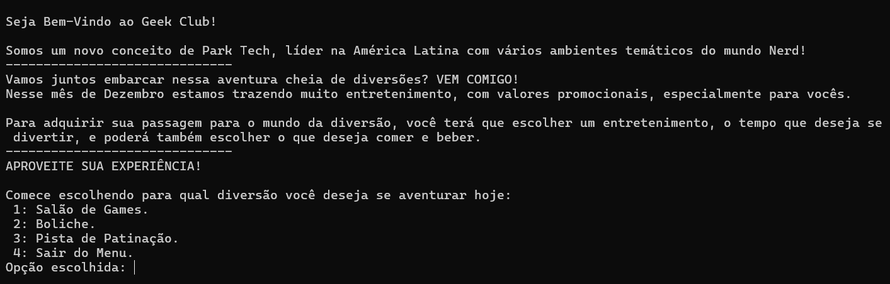
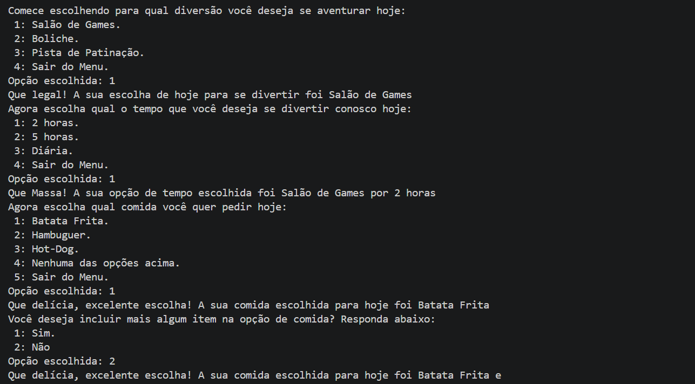
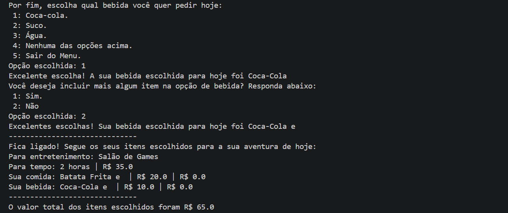
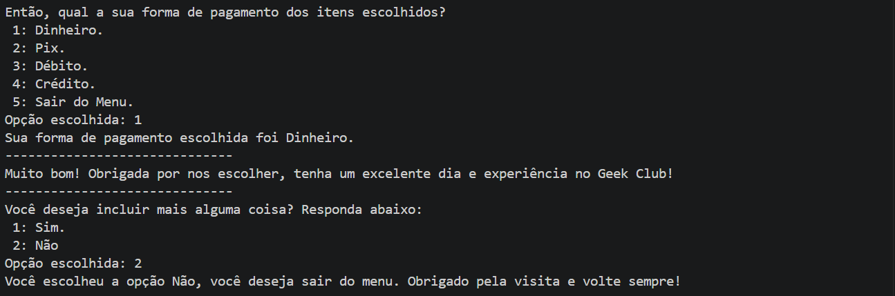

<div align="center">

  

# Geek Club - Menu em Python

**Sistema interativo de entretenimento para praticar Python.**  
*Aprende estruturas de dados e programação enquanto constrói um menu funcional.*

[](#%EF%B8%8F-stack)

</div>

---

## 📑 Sumário

- [O que é isso](#-o-que-é-isso)
- [Resultado do Projeto](#-resultado-do-projeto)
- [Tecnologias](#-tecnologias)
- [Estrutura](#-estrutura)
- [Requisitos do Projeto](#-requisitos-do-projeto)
- [Instruções de Uso](#-instruções-de-uso)
- [Créditos](#-créditos)
- [Autora](#-autora)

---

## 🎯 O que é isso

Esse foi um projeto de encerramento da disciplina de **Estrutura de Dados** e **Programação Orientada a Objetos**, com foco na linguagem `Java`. Após finalizar o projeto [GeekClub - Menu em Java](https://github.com/rhayssakramer/GeekClub-Java.git), aproveitei que aprendi os fundamentos básicos da `Linguagem Python` e resolvi fazer um clone do Projeto de Java em Python, para treinar, fazer comparativos e consolidar o conhecimento entre as duas linguagens.

## ✨ Resultado do Projeto






## 🛠️ Tecnologias

| Linguagens de Programação | Ferramentas e Tecnologias |
| :-----------------: | :-----------------------: |
|  | 

---

## 📁 Estrutura

```
geekclub-python/
├── README.md                 # Documentação do projeto
├── App.py                    # Arquivo principal com o programa completo
└── img/                      # Imagens e recursos visuais
    └── logo.png
```

**Descrição:**
- **App.py** - Arquivo principal contendo todo o código fonte Python do projeto
- **img/** - Armazena as imagens da documentação e visual do projeto

## 🗒️ Requisitos do Projeto

> Projeto - Sistema de Entretenimento

Crie um programa em Python que gerencie um sistema de entretenimento para pessoas. Este sistema deve ter um menu para oferecer opções de lugares para diversão, para comer e beber (pode ter mais coisas, tipo transporte). Cada opção deve ter seu preço. Após captar todos os desejos do usuário, informe quanto deu sua conta total.

#### Exemplo:
- Cinema - O exorcista, Brinquedo Assassino, Frozen.
- Comida - strogonoff, pizza, lasanha.
- Bebida - Caipiroska, Coca-cola, água de côco.

#### Especificações de conteúdo:
- Indique um nome para seu negócio.
- Sua composição de diversão/comida/bebida tem que combinar (fazer sentido).
- O programa deve exibir inicialmente um texto explicando do que se trata seu sistema, após apresentar as primeiras opções ao usuário.
- O sistema só captura uma informação de diversão, uma de comida e uma de bebida.
- Utilizar pelo menos 3 opções de cada seção.
- A saída deve exibir qual a diversão, a bebida e a comida escolhidas, além do preço total.

#### Especificações técnicas:
- Todos os dados são capturados pelo console (entrada do usuário).
- Exibir mensagens apropriadas a cada situação (você tem que interagir com o usuário).
- O usuário tem a opção de não escolher nada.
- Utilizar inteiros para a escolha dos itens: 
`(1) Pepsi`
`(2) Fanta`
`(3) Coca-cola`
- Utilizar pelo menos uma variável:
`String`
`Int`
`Double`
- Utilizar estruturas como:
`if / else`
`if / else if / else`
`switch (opcional)`

---

## ▶️ Instruções de Uso

1. Clone ou baixe este repositório para a sua máquina local.

2. Certifique-se de ter o [Python](https://www.python.org/downloads/) instalado na sua máquina.

3. Abra a IDE (VS Code recomendado) e certifique-se de ter a extensão [Python](https://marketplace.visualstudio.com/items?itemName=ms-python.python) instalada.

4. Abra o terminal integrado: clique em `View` → `Terminal` → `New Terminal`.

5. Navegue até o diretório raiz do projeto.

6. Para executar o programa, digite o comando abaixo e pressione `Enter`:
```
python App.py
```

---

## 🔗 Créditos

Este projeto foi um clone do projeto desenvolvido como parte de avaliação das disciplinas de `Estrutura de Dados` e `Programação Orientada a Objetos`, com o objetivo de avaliar o aprendizado sobre os fundamentos básicos da `Linguagem Python`.

*Nota: Este projeto é apenas para fins educacionais e não possui nenhuma afiliação oficial.*

---

## 👩🏼‍💻 Autora

<table>
  <tr>
    <td align="left">
      <a href="https://github.com/rhayssakramer">
        <strong>Rhayssa Kramer</strong>
      </a>
      <br>
      <span>Assoc, Full-Stack Development</span>
      <br>
      <small>Avanade | Tech Content Creator | Community Speaker</small>
    </td>
  </tr>
</table>

---

<div align="center">

### ⭐ Se este projeto foi útil, considere deixar uma estrela no GitHub!

© 2026 Rhayssa Kramer. Todos os direitos reservados.

<a href="https://github.com/rhayssakramer"></a>

</div>
